# Kalmthoutse Heide SWAP results and SYMPHONICA products

Thematic analysis of the first provisional regional simulation

SYMPHONICA results note | V02 | 19 October 2026

## 1 Main results and their interpretation

The completed model produces a consistent set of daily water, soil moisture and temperature results for 4,096 independent soil columns over 1 January 2024 to 1 October 2026. The strongest contrast is between the relatively wet growing season of 2024 and the drier seasons that follow. For the common 183-day interval from 1 April to 30 September, rainfall is 605.7 mm in 2024, 256.5 mm in 2025 and 324.5 mm in 2026. Requested total evaporation, calculated as transpiration plus soil evaporation plus the native interception term, is 645.0, 370.4 and 443.5 mm respectively. These are averages of the model columns over the existing pilot grid.

The lower evaporation in 2025 occurs despite a warmer and brighter growing season than in 2024. Available soil water, vegetation demand and the imposed boundaries constrain the response. The strongest modelled transpiration limitation occurs in the forest class. The ratio of actual to potential forest transpiration over April to September changes from 0.539 in 2024 to 0.141 in 2025. This is a diagnostic of the specified model configuration. It is not a measured stress index or evidence that actual forests in the area experienced precisely this reduction.

Depth matters. Mean April to September shallow soil water concentration falls from 216.3 kg m⁻³ in 2024 to 125.9 kg m⁻³ in 2025, at the actual centre depth of 10.5 cm. At 162.5 cm, corresponding means are 226.2 and 194.5 kg m⁻³. Deeper states vary more slowly and retain a different seasonal history. Soil temperatures show the expected qualitative damping and delayed seasonal maximum with depth, although their absolute values remain sensitive to the thermal boundary and initial profile.

We can calculate a GPP-equivalent flux for the 802 grass and 503 maize-proxy columns. Those cover 31.86% of the model grid. Forest, heath, urban surrogates and wetlands have no assimilation model in this configuration. Their GPP remains missing. A spatial mean calculated only over the available crop cells would describe that subset, not ecosystem GPP for the full Kalmthoutse Heide domain.

This note accompanies the earlier technical construction note. It adds interpretation of the computed results and an executable conversion to candidate SYMPHONICA outputs. It also refines the earlier generic description of GASST: the native label alone does not capture the carbon-fraction correction applied in the SWAP 4.3.1 crop source. The conversion below accounts for that correction explicitly.

The results remain a technical exercise and a first provisional version. They have not been calibrated or independently validated against field observations. The workflow is intended to connect to the standard datasets being collected and made accessible within SYMPHONICA. The products supplied here implement the requested variable meanings and units, while the final project schema, approved sources and ingestion conventions still need agreement.

## 2 What is being averaged

The domain is the 16 km by 16 km minimal pilot extent, including the surroundings of the nature reserve. It contains a 64 by 64 grid of 250 m cells in EPSG:32631. Each cell has an area of 62,500 m² and contains a separate two-metre soil column. The columns do not exchange lateral groundwater or surface water. Their spatial variation comes from input and parameter differences, not from a coupled regional aquifer solution.

All cells use the same hourly ERA5 forcing at the representative extraction location. Regional totals in this note first average over equally sized cells and then sum daily interval quantities. Class totals follow the same operation within each class. They are water depths per modelled column area. The grid is not an exclusive mask of the reserve, and the model uses a dominant terrestrial response in mixed-cover cells. Open water and impervious urban surfaces do not receive complete separate hydrological models.

| Model route | Cells | Grid area km² | GPP available |
| --- | --- | --- | --- |
| Forest | 2163 | 135.2 | No |
| Heath | 229 | 14.3 | No |
| Grass | 802 | 50.1 | Yes |
| Maize proxy | 503 | 31.4 | Yes |
| Urban surrogate | 396 | 24.8 | No |
| Wetland | 3 | 0.2 | No |

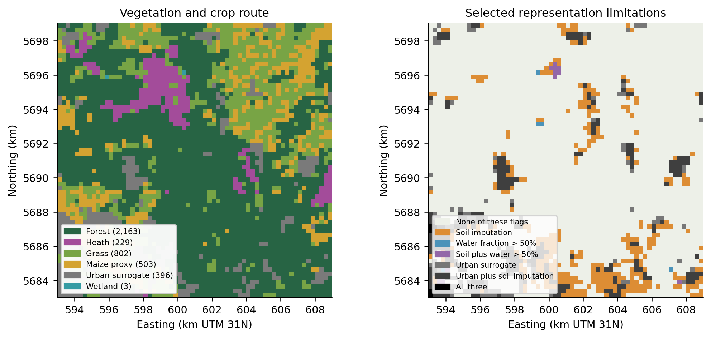

Figure 1. Vegetation assignments and selected representation limitations. Soil imputation affects 640 cells; 24 have more than 50% mapped water, and 396 use an urban pervious-soil surrogate. Combinations of these flags are shown separately. These maps describe the model representation and input provenance, not observation quality at every location.

Averages across these classes are descriptive. Forest and grass differ in soils, rooting, canopy parameters and sometimes their mapped setting. The comparisons are not controlled experiments that change vegetation alone. Wetland results use only three cells with an assumed shallow groundwater boundary; these cells must not be treated as a statistically representative sample of wetlands.

## 3 Variable definitions and conversion to SYMPHONICA

### 3 1 Evaporation in millimetres per day

The requested definition is ET = 10 × (TACT + EACT + EIC). TACT, EACT and EIC are native daily interval water depths in cm. Multiplication by 10 changes cm to mm. Because every interval is exactly one UTC day, the numeric daily depth in mm equals the mean rate in mm d⁻¹ for that interval. The calculation retains the native signs and accounting definitions.

EPD, evaporation from ponded water, is deliberately separate from that requested sum. The additional variable ET_including_pond equals ET + 10 × EPD. In this particular delivery the distinction is numerically negligible: the 2024 domain mean accumulated pond evaporation is approximately 0.0000007 mm and it is zero in the other two periods. Keeping it separate is still necessary for future configurations with meaningful ponding, lakes or surface storage.

EIC includes the native canopy accounting treatment at crop-calendar transitions. ET therefore inherits the known canopy-reset limitations. The converter preserves canopy_reset_flag and the independent balance residual. It does not remove small flagged discrepancies or relabel all interception accounting as pure measured canopy evaporation.

### 3 2 Soil moisture in kilograms per cubic metre

The requested soil moisture is the mass of water per bulk volume of soil. We calculate soil_moisture = 1,000 × WC, using a constant water density of 1,000 kg m⁻³. For example, WC = 0.25 m³ m⁻³ becomes 250 kg m⁻³. A temperature-dependent water density is not applied.

This is not gravimetric moisture in kg water per kg dry soil. No bulk-density multiplication is needed for the specified kg m⁻³ quantity. It is also not water storage in kg m⁻² or a layer-integrated root-zone moisture product. The five WC values are states at five actual compartment centres. Multiplying by water density does not change their spatial or temporal support.

### 3 3 GPP as a daily mean carbon dioxide flux

GASST is the crop model's gross assimilation output before maintenance respiration is subtracted. SWAP 4.3.1 first converts gross CO2 assimilation to its internal assimilate equivalent using PGASS = DTGA × 30 × (0.4 / CFRDM) / 44. It then applies the retained management and water-stress responses to obtain actual gross assimilation. The CSV GASST field reads the integrated IGASS accumulator, which is reset at output intervals. These relationships were checked in the executed version's wofost.f90, swap_csv_output.f90 and integral.f90 source.

CFRDM is 0.45 in the grass file and 0.40 in the maize file. To recover the carbon amount represented by GASST, we multiply by that carbon fraction. Using the model's nominal molar carbon mass of 12 g mol⁻¹ gives:

GPP = GASST × CFRDM × 1,000 / 12 / 10,000 × 1,000,000 / 86,400.

The steps convert kg of assimilate equivalent per hectare and day into grams of carbon, moles of carbon, area per square metre, micromoles and seconds. One mole of assimilated carbon corresponds to one mole of CO2. For 86,400-second intervals, the factors are 0.04340278 for grass and 0.03858025 for maize. Thus 100 native units give 4.3403 µmol CO2 m⁻² s⁻¹ for grass and 3.8580 for maize.

The grass factor is 12.5% higher than a universal CH2O-based factor using 30 g mol⁻¹. Put the other way around, that universal factor would underestimate the corrected grass flux by 11.1%. For maize, CFRDM=0.40 makes the familiar CH2O conversion equivalent. Applying one generic factor without inspecting CFRDM would lose this distinction.

The conversion retains the model's management factor, including RELMF=0.7 for grass and 1.0 for maize, and the actual stress effects. It does not reconstruct hypothetical assimilation before those reductions. We call the resulting quantity a model GPP equivalent because its biological assumptions remain those of the selected WOFOST configuration. It is not net primary production, harvested carbon, net ecosystem exchange or an independently measured carbon budget.

The result is a mean over the complete 24-hour interval, including night. It is not a midday or daylight-average photosynthesis rate. A daytime flux, hourly curve or diurnal amplitude cannot be recovered by changing units in daily GASST. Positive values denote uptake. Where the prescribed vegetation route does not calculate assimilation, GPP remains NaN. Existing no-active-dynamic-crop zeros retain their availability flag.

### 3 4 Temperature and time coordinates

Soil temperature is already in degrees Celsius and is copied unchanged. We do not subtract 273.15. WC and T are day-end states, whereas ET and GPP describe daily intervals. The input coordinate time is the upper daily bound: simulation_date=2025-01-01 therefore has time at 2025-01-02 00:00 UTC. The converter preserves simulation_date, time_bounds, the actual depth coordinate, cell identifiers and flags.

| Requested product | Calculation | Unit and support |
| --- | --- | --- |
| ET | 10 × (TACT + EACT + EIC) | mm d⁻¹, complete UTC-day mean |
| soil_moisture | 1,000 × WC | kg m⁻³ of bulk soil, day-end state |
| GPP | GASST × CFRDM × 0.0964506173 | µmol CO2 m⁻² s⁻¹, complete UTC-day mean |
| soil_temperature | T unchanged | °C, day-end state |
| ET_including_pond | ET + 10 × EPD | mm d⁻¹, additional diagnostic |

The NetCDF GPP unit attribute is encoded as umol m-2 s-1, with substance=CO2 stored separately. This avoids putting an unrecognised substance token into the physical unit string. The four required products have explicit long names, units, temporal methods, coordinates and provenance. File-level metadata identifies the mapping as a provisional candidate, rather than an approved SYMPHONICA schema. The converter verifies the pinned V02 source-file hashes before applying the mapping. A new model version requires a reviewed mapping rather than silent reuse of these constants. Future rotations with changing crops would need CFRDM to follow the active crop in time; the static cell values used here are valid for the repeated V02 crop assignments.

## 4 Three contrasting periods

Only 2024 and 2025 are complete calendar years. The 2026 file ends on 1 October and contains 274 days. Its available-period sum is not an annual total. To compare all three years, we use 1 April through 30 September, a complete 183-day window in each year. This also avoids a leap-day mismatch in seasonal totals. Full annual averages and sums are retained separately.

| Year | Available days | Annual or available P mm | April to September P mm | April to September air °C | Season radiation MJ m⁻² |
| --- | --- | --- | --- | --- | --- |
| 2024 | 366 | 1,070.9 | 605.7 | 16.0 | 2,887.8 |
| 2025 | 365 | 600.7 | 256.5 | 16.8 | 3,232.9 |
| 2026 | 274 | 545.0 | 324.5 | 17.3 | 3,259.3 |

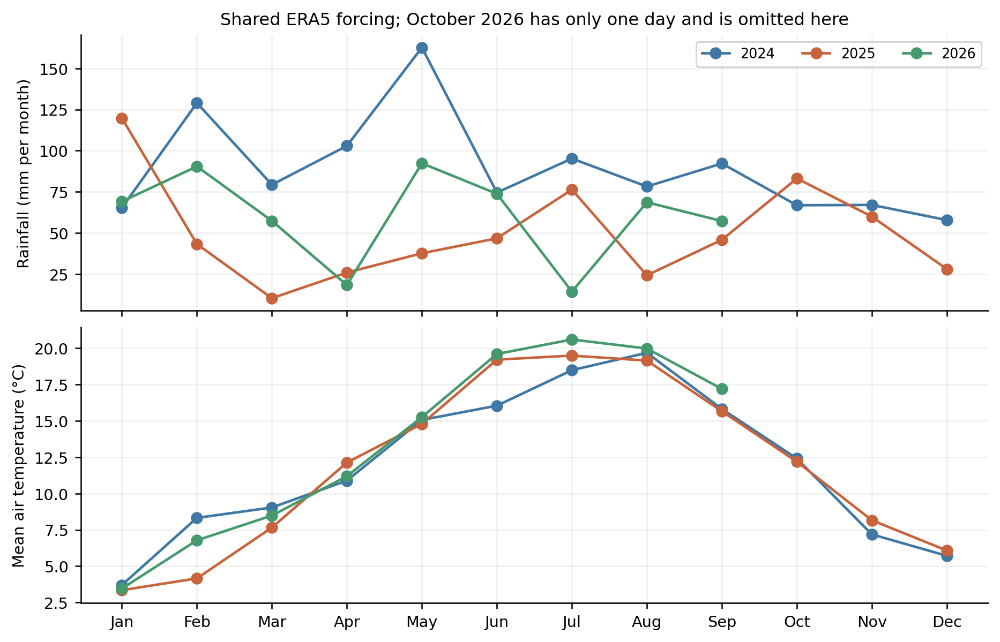

Figure 2. Monthly forcing separates the wet 2024 season from the dry spring and early summer of 2025. The April to September air-temperature means are 16.03, 16.76 and 17.33 °C. Partial October 2026 is omitted from these monthly overlays. All cells share this forcing, so the figure contains no spatial weather variation.

Within this short record, 2024 is the wetter and cooler growing-season case, 2025 is the driest growing-season case, and 2026 combines the warmest growing season with intermediate seasonal rainfall. These descriptions are comparisons among these three simulations. They are not climatological classifications such as a return-period drought, an exceptionally wet year relative to a 30-year normal or evidence of a long-term trend.

The seasonal rainfall decrease from 2024 to 2025 is 57.7%, whereas shortwave radiation increases by about 12.0%. Mean growing-season air temperature rises by 0.73 °C. Annual mean air temperatures for the two full years are both about 11.88 °C. That near equality illustrates why a complete-year temperature mean can conceal substantial seasonal differences relevant to water demand and plant growth.

The simulation has no prior spin-up. Its initial uniform pressure head is an imposed state rather than an observed equilibrium. Consequently, 2024 differs from subsequent years both in forcing and in proximity to initialisation. The following calculations show the actual model response, but they do not isolate a pure weather effect. A weather-only comparison would require controlled initial states or a qualified spin-up design.

## 5 Water use and storage over the whole grid

| Year and window | P mm | ET mm | T mm | Soil E mm | Canopy mm | Bottom outflow mm | Native storage change mm |
| --- | --- | --- | --- | --- | --- | --- | --- |
| 2024 full | 1,070.9 | 823.2 | 312.3 | 225.0 | 285.8 | 455.5 | -207.7 |
| 2025 full | 600.7 | 558.5 | 178.5 | 188.8 | 191.3 | 116.4 | -74.2 |
| 2026 to 1 Oct | 545.0 | 546.0 | 190.5 | 175.7 | 179.8 | 59.2 | -60.2 |

The storage column is the sum of native DSTOR, not an independently reconstructed end-state difference. Bottom outflow equals -10 × BOT and is positive outward. The native BALDEV sums and independent canopy flags remain in the machine-readable tables. Rounded values in this printed table will not reproduce the tiny residuals of the unrounded native ledger.

In 2024 the model evaporates 823.2 mm and releases 455.5 mm through the bottom boundary against 1,070.9 mm rainfall. Native storage declines by 207.7 mm, supplying part of those losses. Evaporation plus bottom outflow can therefore exceed contemporaneous rainfall without violating the native period accounting. It does show how strongly the first-year interpretation depends on initial water storage. Calling the 455.5 mm a measured or validated recharge estimate would be unjustified.

In 2025 rainfall is 600.7 mm, evaporation 558.5 mm and net bottom outflow 116.4 mm. A further 74.2 mm native storage decline contributes to the balance. The 2026 available period has evaporation of 546.0 mm, nearly equal to its 545.0 mm rainfall, while approximately 59.2 mm bottom outflow is supplied together with a 60.2 mm storage decline. These are independent-column budgets under the imposed lower boundaries, not a coupled regional groundwater balance.

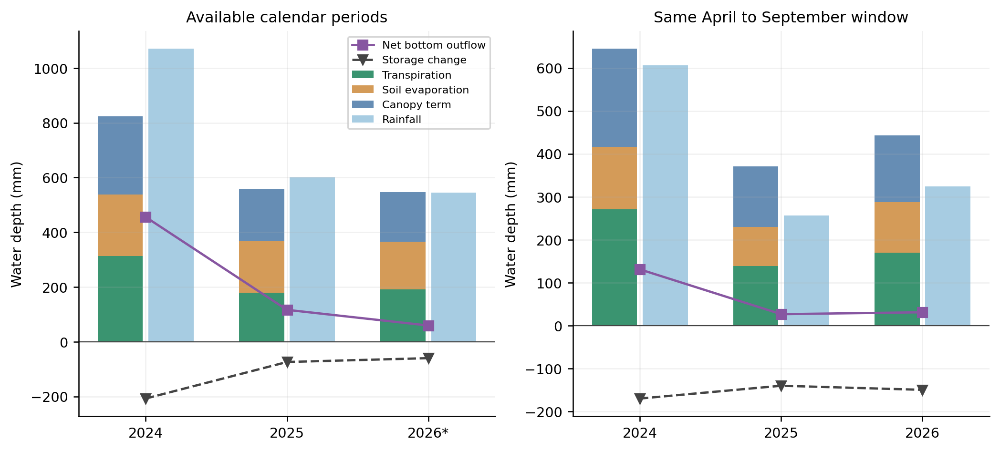

Figure 3. Evaporation components and precipitation are plotted alongside net bottom outflow and native storage change. The left panel contains complete 2024 and 2025 plus the partial 2026 period, marked with an asterisk. The right panel uses the same April to September window in all years. Lines and bars use a common water-depth axis; the displayed quantities should not all be added as independent losses.

| Common season | P mm | ET mm | ET mm d⁻¹ | Bottom outflow mm | Native storage change mm | T actual over potential |
| --- | --- | --- | --- | --- | --- | --- |
| 2024 | 605.7 | 645.0 | 3.525 | 130.8 | -170.1 | 0.665 |
| 2025 | 256.5 | 370.4 | 2.024 | 26.4 | -140.3 | 0.231 |
| 2026 | 324.5 | 443.5 | 2.423 | 30.9 | -149.8 | 0.280 |

In the matched season, ET decreases by 42.6% from 2024 to 2025, then increases by 19.7% in 2026. Seasonal ET exceeds seasonal rainfall in every year: by 39.3 mm in 2024, 113.9 mm in 2025 and 119.0 mm in 2026. The excess is not itself the storage decline because bottom exchange, runoff and native balance terms also enter the budget. The complete period equations are provided in the CSV tables.

No surface runoff is produced anywhere in the delivered native daily fields. Artificial drainage and irrigation are disabled. Zero runoff is an output of these columns and boundary assumptions. It does not establish that the real domain has no runoff, ditch drainage or urban stormflow. The absent impervious and open-water processes are particularly relevant to that interpretation.

## 6 Evaporation through time and across vegetation

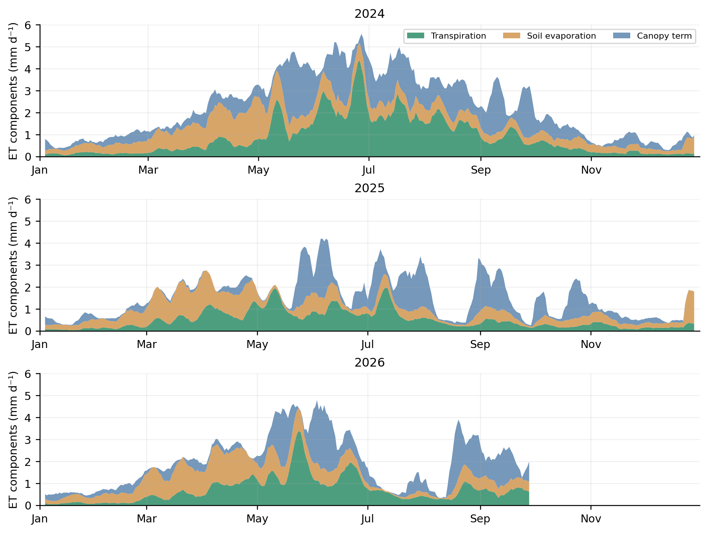

Figure 4. Seven-day centred means of the domain evaporation components. Smoothing is used only for display; all totals use unsmoothed daily quantities. The moist 2024 season supports a broader period of high transpiration, while 2025 has a smaller transpiration contribution and a larger relative role for rainfall-linked canopy evaporation. The blank end of 2026 is unavailable output, not zero evaporation.

The interception contribution is substantial. In the full 2024 period, it is 285.8 mm, around 34.7% of requested ET. For the same April to September period, the canopy share increases from 35.5% in 2024 to 38.1% in 2025 as transpiration decreases. That does not mean canopies become intrinsically more efficient interceptors in a dry year. The relative share also changes because another component declines. Its magnitude depends strongly on the prescribed forest canopy and interception settings.

Individual daily values can be higher than the smoothed curves suggest. The maximum domain mean requested ET is 8.00 mm d⁻¹ on 15 June 2024, 7.10 on 3 September 2025 and 6.88 on 2 June 2026. A rainfall-driven canopy term can produce an evaporation peak on a day that is not the hottest day. These peaks are model results and have not been checked against an independent energy or flux observation.

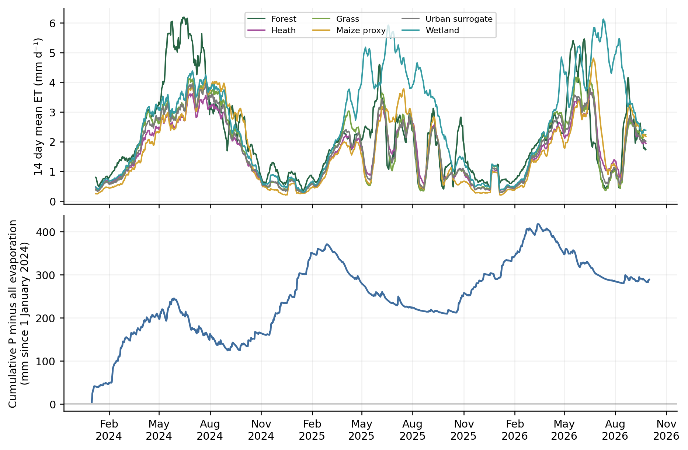

Figure 5. Fourteen-day mean ET by class and the cumulative difference between rainfall and evaporation including pond evaporation. The lower curve is an input-output difference, not a groundwater storage series or a standard drought index. It omits lower-boundary exchange from the plotted difference; those fluxes must be included in a full water balance.

The three wetland columns maintain high evaporation in 2025 and 2026. Their groundwater assumption is a ready explanation within this model: they have access to an imposed shallow-head boundary. In the 2025 common season those columns receive 492.3 mm of net upward bottom exchange, compared with 256.5 mm rainfall, and evaporate 748.8 mm. The native storage change is only about +0.1 mm. Their response therefore depends strongly on imposed boundary supply and cannot be interpreted as evidence that natural wetlands are unaffected by drought. The contrast with freely draining forest columns demonstrates the combined effect of representation choices and boundary supply, not a controlled physiological comparison.

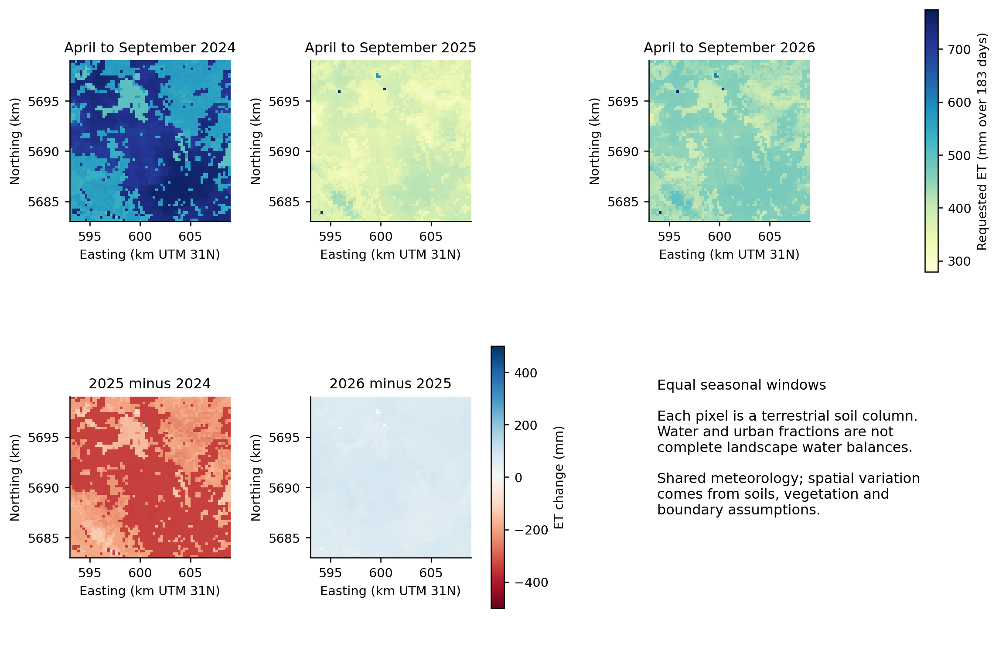

Figure 6. Requested total evaporation over the same 183-day season, with a common scale across the top maps. Difference maps use a common centred scale. The 2025 decrease is widespread and strongest in much of the forest-dominated region. The maps show assigned-column responses; the grid has neither lateral redistribution nor spatial meteorological variation.

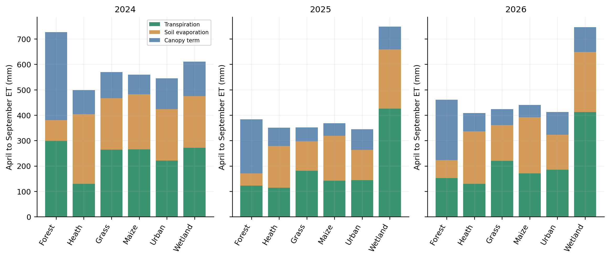

Figure 7. Class mean seasonal ET separated into transpiration, soil evaporation and the native canopy term. Forest has the largest canopy contribution; heath has a large soil-evaporation share under its prescribed canopy. Wetland values are based on only three cells with a distinct groundwater assumption. Differences therefore combine vegetation, soils and boundary conditions.

| Year | Class | ET mm | T mm | Soil E mm | Canopy mm | T ratio |
| --- | --- | --- | --- | --- | --- | --- |
| 2024 | Forest | 726.9 | 299.2 | 81.8 | 345.9 | 0.539 |
| 2024 | Heath | 498.8 | 130.1 | 274.5 | 94.1 | 0.993 |
| 2024 | Grass | 569.4 | 264.5 | 202.1 | 102.8 | 0.998 |
| 2024 | Maize proxy | 559.4 | 265.1 | 217.4 | 77.0 | 0.988 |
| 2024 | Urban surrogate | 544.6 | 221.1 | 202.7 | 120.8 | 0.969 |
| 2024 | Wetland | 611.0 | 271.6 | 204.0 | 135.3 | 1.000 |
| 2025 | Forest | 384.0 | 122.2 | 49.1 | 212.7 | 0.141 |
| 2025 | Heath | 350.8 | 113.9 | 164.9 | 72.0 | 0.602 |
| 2025 | Grass | 351.7 | 181.4 | 116.3 | 54.0 | 0.559 |
| 2025 | Maize proxy | 368.3 | 141.7 | 177.0 | 49.6 | 0.553 |
| 2025 | Urban surrogate | 344.7 | 144.1 | 118.7 | 81.9 | 0.422 |
| 2025 | Wetland | 748.8 | 426.3 | 232.7 | 89.8 | 1.000 |
| 2026 | Forest | 460.4 | 152.8 | 70.6 | 237.0 | 0.175 |
| 2026 | Heath | 408.8 | 129.5 | 206.7 | 72.5 | 0.676 |
| 2026 | Grass | 424.1 | 219.9 | 141.6 | 62.6 | 0.684 |
| 2026 | Maize proxy | 439.7 | 170.8 | 220.8 | 48.1 | 0.537 |
| 2026 | Urban surrogate | 412.5 | 184.9 | 138.6 | 89.0 | 0.550 |
| 2026 | Wetland | 746.7 | 412.3 | 236.5 | 98.0 | 1.000 |

Forest seasonal ET falls from 726.9 mm to 384.0 mm between 2024 and 2025, whereas the heath response falls from 498.8 to 350.8 mm. In 2025 forest transpiration is only 122.2 mm, compared with 212.7 mm in its canopy term. Heath transpiration changes less, from 130.1 to 113.9 mm, while its soil evaporation declines strongly. This apparent contrast is consistent with the different imposed demands and canopy representations. It cannot establish that actual heath vegetation is more drought resistant than the local forests.

The maize proxy and grass class have similar total ET in the matched 2025 season, 368.3 and 351.7 mm, but their components differ. Maize has 177.0 mm soil evaporation and 141.7 mm transpiration, while grass has 116.3 and 181.4 mm. Thus similar total evaporation can conceal substantially different soil exposure, active canopy periods and carbon-water response.

## 7 Transpiration limitation and its meaning

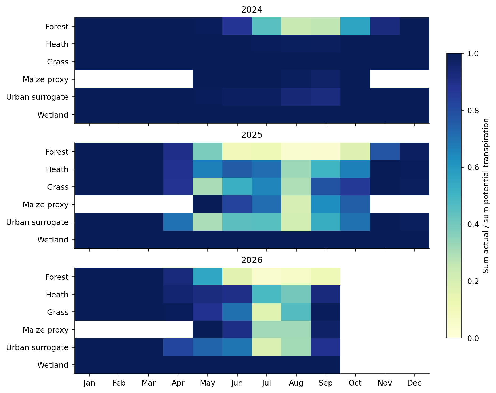

Figure 8. Monthly sum of actual transpiration divided by monthly sum of potential transpiration within each class. Ratios near one indicate little reduction under the model definition. White means unavailable or no meaningful potential demand; partial October 2026 is omitted. Ratios are formed from sums, not by averaging unstable daily ratios when potential transpiration is close to zero.

The domain seasonal actual-to-potential transpiration ratio is 0.665 in 2024, 0.231 in 2025 and 0.280 in 2026. Because forest occupies 52.8% of the grid and has a high potential demand, it strongly influences the aggregate. A domain ratio is not an area average of class ratios and cannot be interpreted as the fraction of plants suffering stress.

The forest seasonal ratio is 0.141 in 2025 and 0.175 in 2026. Grass has ratios of 0.559 and 0.684, and maize 0.553 and 0.537. The slightly lower maize ratio in the warmer 2026 season coexists with higher integrated maize assimilation and transpiration than in 2025. Potential demand and the temporal overlap between growth, weather and stress differ, so a single ratio does not fully rank crop performance.

The current output does not split every transpiration reduction into independent drought and oxygen components. Dynamic crops retain their source drought, oxygen and rooting settings, while prescribed vegetation follows its own parameter route. We therefore describe the diagnostic as transpiration limitation. Attributing the entire reduction to one stress mechanism would require its specific output fields and a corresponding audit.

## 8 Soil moisture across depth and time

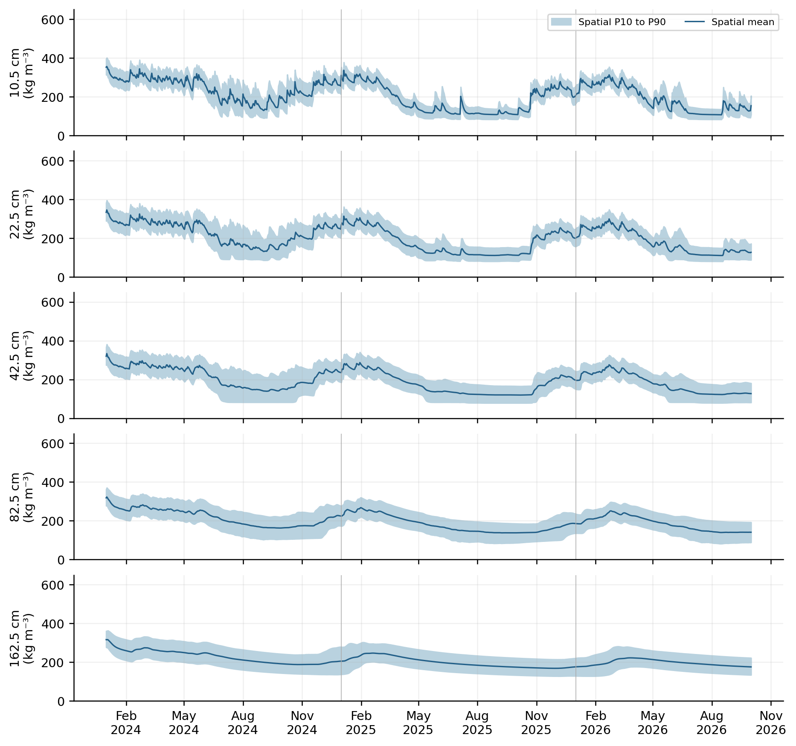

Figure 9. Daily end-state water mass concentration at the five actual output centres. The line is the spatial mean over all model columns and the band is the spatial 10th to 90th percentile. The band describes spatial heterogeneity, not parameter uncertainty, an observational range or a confidence interval. Vertical scales are identical across the five panels.

At 10.5 cm the lowest spatial mean is 128.6 kg m⁻³ on 2 September 2024, 107.5 on 3 October 2025 and 106.5 on 16 August 2026. The 2026 minimum is the lowest observed in that available model period. It is not a complete-year minimum. The driest domain-average date is also not the driest date in every cell, so spatial maps below use one common date rather than mix cell-specific minima.

The 2025 minimum occurs after the common April to September comparison window. That illustrates why matching seasonal totals is useful but does not capture every late-season state. Interannual comparisons should retain both the common window and the complete available chronology, especially when autumn rewetting or carry-over storage matters.

| Actual centre cm below surface | 2024 season kg m⁻³ | 2025 season kg m⁻³ | 2026 season kg m⁻³ |
| --- | --- | --- | --- |
| 10.5 | 216.3 | 125.9 | 148.4 |
| 22.5 | 204.3 | 127.5 | 144.6 |
| 42.5 | 197.4 | 139.2 | 149.2 |
| 82.5 | 209.5 | 161.9 | 166.9 |
| 162.5 | 226.2 | 194.5 | 196.0 |

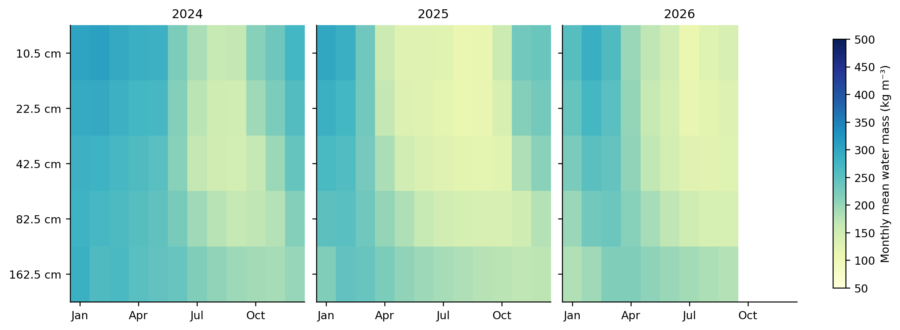

Figure 10. Monthly means at the sampled centres show stronger shallow drying and slower changes at depth. Rows are the five discrete output centres, displayed with equal categorical spacing. They are not a vertically interpolated continuous moisture field. Partial October 2026 is excluded, and the remaining months are unavailable.

Over April to September, the 2024-to-2025 moisture decrease is 90.4 kg m⁻³ at 10.5 cm but 31.7 at 162.5 cm. In 2026 shallow seasonal moisture partly recovers to 148.4 kg m⁻³, while the deep mean is 196.0, only slightly above 2025 and still below 2024. This is consistent with different response times and a history of deep storage depletion. The present simulation does not prove the persistence of an observed regional groundwater deficit.

A value at 162.5 cm is soil water content at that centre, not a water-table measurement. Free drainage does not provide a resolved regional groundwater level. Similarly, the five reported concentrations cannot be integrated exactly into two-metre storage without the full compartment values and thicknesses. Native WTOT and DSTOR are the appropriate authorities for full-profile storage in this delivery.

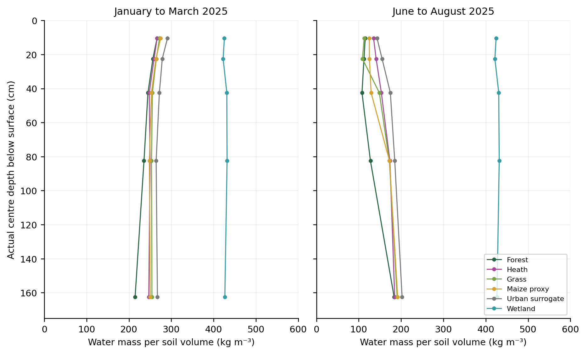

Figure 11. Class mean profiles from January to March and June to August 2025. Connected markers link the five sampled centres only. The wetland profile reflects the imposed shallow water supply, while freely draining classes show greater seasonal change. Source layers, soil assignments, vegetation and boundary types differ among classes; these profiles cannot isolate rooting effects alone.

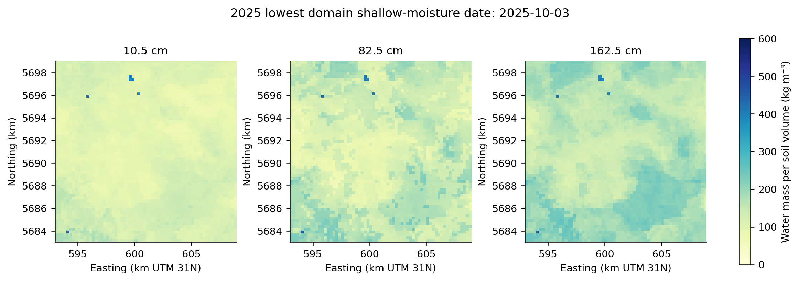

Figure 12. Water concentration at 10.5, 82.5 and 162.5 cm on 3 October 2025, the date of the lowest domain-average shallow moisture that year. Maps share the same concentration scale. Deeper spatial patterns differ from the very dry shallow pattern. The highest wet values include columns influenced by different soil or lower-boundary assumptions.

Concentrations in kg m⁻³ make the amount of water per soil volume clear, but equal concentrations do not imply equal plant water availability. Soil retention curves determine the associated pressure head and accessible water. A fixed regional threshold in kg m⁻³ would ignore differences in residual water content, porosity, texture and rooting. Establishing such a threshold requires a specific ecological or agricultural definition and suitable validation.

## 9 Soil temperature and thermal response

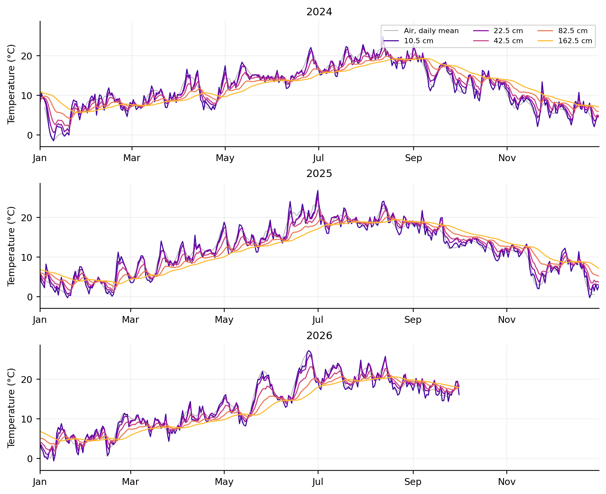

Figure 13. Spatial means of day-end soil temperature, together with a seven-day mean of the daily mean air forcing. The air and soil curves have different temporal sampling support and should not be subtracted as a calibrated temperature bias. Soil responses are increasingly damped at depth. Numerical heat is active, while frozen-water hydrology remains disabled.

| Actual centre cm below surface | 2024 season °C | 2025 season °C | 2026 season °C |
| --- | --- | --- | --- |
| 10.5 | 15.8 | 16.6 | 17.1 |
| 22.5 | 16.1 | 16.8 | 17.3 |
| 42.5 | 15.6 | 16.2 | 16.6 |
| 82.5 | 15.1 | 15.6 | 16.0 |
| 162.5 | 14.7 | 15.1 | 15.6 |

The April to September mean temperature at 10.5 cm increases from 15.81 °C in 2024 to 16.56 in 2025 and 17.09 in 2026. The corresponding deep means are 14.75, 15.13 and 15.55 °C. The seasonal warming signal is therefore present at every reported depth, with a smaller magnitude deeper in the profile. This describes these input years and model assumptions; it is not a trend estimate.

The initial thermal profile is linear from 7.5125 °C at the surface to 11.8794 °C at two metres. The upper thermal boundary uses air temperature and the bottom imposes zero heat flux. These choices, the soil thermal parameter conversion and the absence of thermal spin-up limit interpretation of both first-year means and deep thermal behaviour. The annual mean profile need not be monotonic, particularly when comparing temperatures sampled at the day end rather than true daily means.

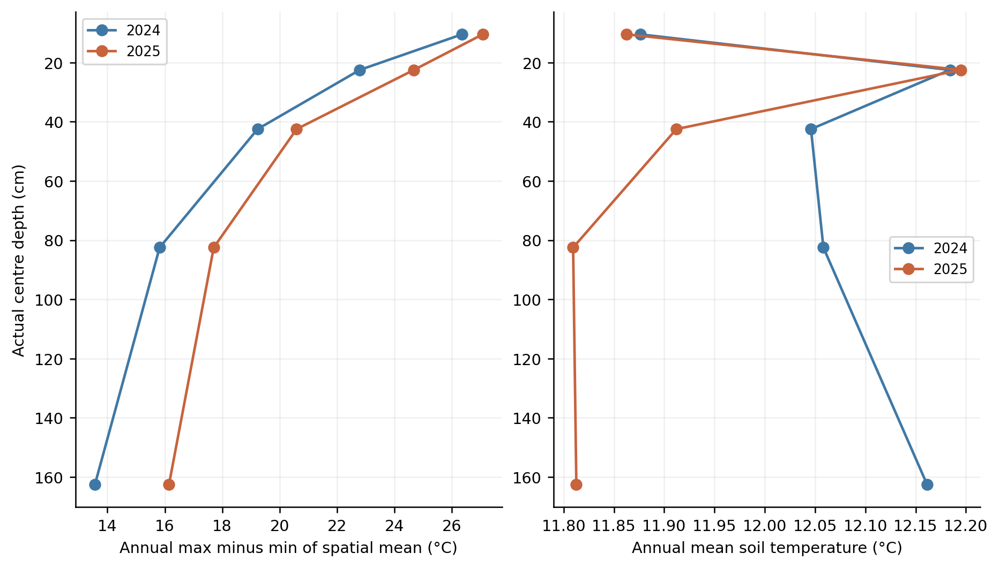

Figure 14. Annual range and annual mean of the spatially averaged day-end soil temperatures for the two complete years. The range is maximum minus minimum of that daily series, not the full within-day amplitude or the range over every cell. Deep values respond less strongly than shallow values. The mean-profile differences are small and remain affected by initialisation and boundary assumptions.

| Year | Depth cm | Range of spatial mean °C | Date of maximum |
| --- | --- | --- | --- |
| 2024 | 10.5 | 26.4 | 2024-08-12 |
| 2024 | 22.5 | 22.8 | 2024-08-12 |
| 2024 | 42.5 | 19.2 | 2024-08-13 |
| 2024 | 82.5 | 15.8 | 2024-08-14 |
| 2024 | 162.5 | 13.6 | 2024-08-21 |
| 2025 | 10.5 | 27.1 | 2025-07-01 |
| 2025 | 22.5 | 24.7 | 2025-07-01 |
| 2025 | 42.5 | 20.6 | 2025-07-02 |
| 2025 | 82.5 | 17.7 | 2025-08-16 |
| 2025 | 162.5 | 16.1 | 2025-08-23 |

In 2025 the annual range of the spatial mean declines from 27.08 °C at 10.5 cm to 16.15 °C at 162.5 cm. The shallow maximum occurs on 1 July, while the deep maximum occurs on 23 August. These are calendar dates of the maxima in a season containing several warm episodes. Their 53-day difference is not an estimate of the travel time of one isolated heat pulse.

The minimum over every exported cell and depth is about -1.99 °C in 2024, -0.72 in 2025 and -0.88 in 2026. A negative soil temperature does not establish simulated ice content or frozen-soil hydraulic effects because SWFROST remains off. Sensor comparison should use the true model centre depth and the native sampling time, and should consider whether above-canopy air temperature is an adequate ground thermal boundary.

## 10 Crop assimilation and GPP coverage

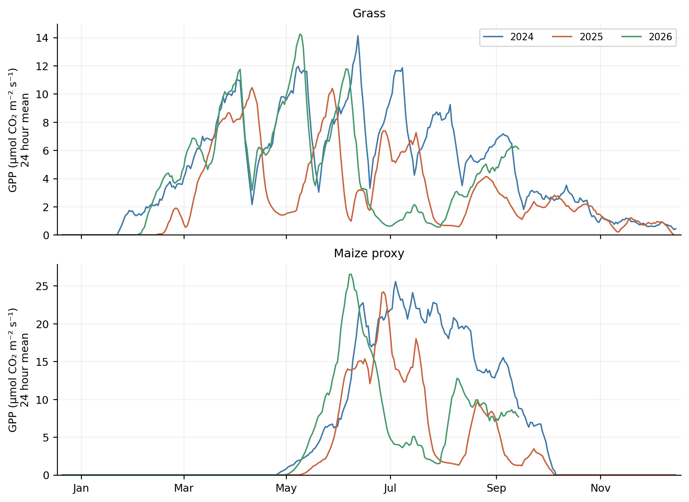

Figure 15. Seven-day mean GPP equivalent by dynamic crop and year, expressed as a 24-hour average. Crop calendars, temperature-dependent start and growth, mowing and water limitation shape the curves. The panels use their own vertical ranges so that grass seasonality remains visible; compare numeric values using the labelled axes. The absence of maize assimilation outside its active period is distinct from missing forest or heath assimilation.

| Year | Window | Crop | GPP g C m⁻² | Mean GPP µmol CO2 m⁻² s⁻¹ |
| --- | --- | --- | --- | --- |
| 2024 | Year | Grass | 1,779.6 | 4.690 |
| 2024 | Apr to Sep | Grass | 1,434.7 | 7.562 |
| 2024 | Year | Maize proxy | 2,215.4 | 5.838 |
| 2024 | Apr to Sep | Maize proxy | 2,119.3 | 11.170 |
| 2025 | Year | Grass | 1,042.5 | 2.755 |
| 2025 | Apr to Sep | Grass | 846.5 | 4.462 |
| 2025 | Year | Maize proxy | 1,146.7 | 3.030 |
| 2025 | Apr to Sep | Maize proxy | 1,107.2 | 5.835 |
| 2026 | To 1 Oct | Grass | 1,205.0 | 4.242 |
| 2026 | Apr to Sep | Grass | 1,024.9 | 5.402 |
| 2026 | To 1 Oct | Maize proxy | 1,282.2 | 4.513 |
| 2026 | Apr to Sep | Maize proxy | 1,275.8 | 6.724 |

In the matched season, grass gross carbon assimilation decreases from 1,434.7 g C m⁻² in 2024 to 846.5 in 2025, then recovers to 1,024.9 in 2026. Maize-proxy values are 2,119.3, 1,107.2 and 1,275.8 g C m⁻². Relative to 2024, the 2025 decreases are 41.0% for grass and 47.8% for maize. The 2026 values remain below 2024 despite their increase from 2025.

The full-year grass and maize means in 2024 are 4.690 and 5.838 µmol CO2 m⁻² s⁻¹. Growing-season means are higher because the annual mean includes winter and inactive periods. These are model gross fluxes before respiratory deductions. They do not describe yield, net biomass accumulation or ecosystem carbon storage. Mowing and harvest can affect subsequent assimilation, but exported GASST alone cannot reconstruct the fate of harvested or respired carbon.

The result is also sensitive to the generic crop choice. Maize was assigned to every broad agricultural cell, rather than mapped from actual annual crops. Grass includes cells that might in reality be unmanaged grass or another vegetation type. The source management reduction remains in the flux after conversion, so the result should not be interpreted as theoretical unstressed photosynthetic capacity.

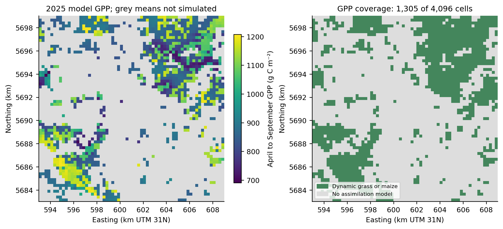

Figure 16. Matched-season GPP in 2025 and the corresponding spatial availability mask. Grey cells have no assimilation model and remain missing. The 1,305 available cells represent 81.5625 km² of the 256 km² grid. A full-domain ecosystem GPP total is not produced, since the missing 68.14% includes the dominant forest class and the heath area of interest.

A map or average must preserve this coverage. Setting missing forest GPP to zero would systematically change the meaning of regional carbon uptake. Averaging only valid cells without stating the denominator would likewise make a crop-subset statistic look like a regional ecosystem statistic. The delivered GPP field therefore retains NaN values and GASST_flag, and this note reports class means rather than a misleading full-domain mean.

## 11 Carbon and water are linked inside the model

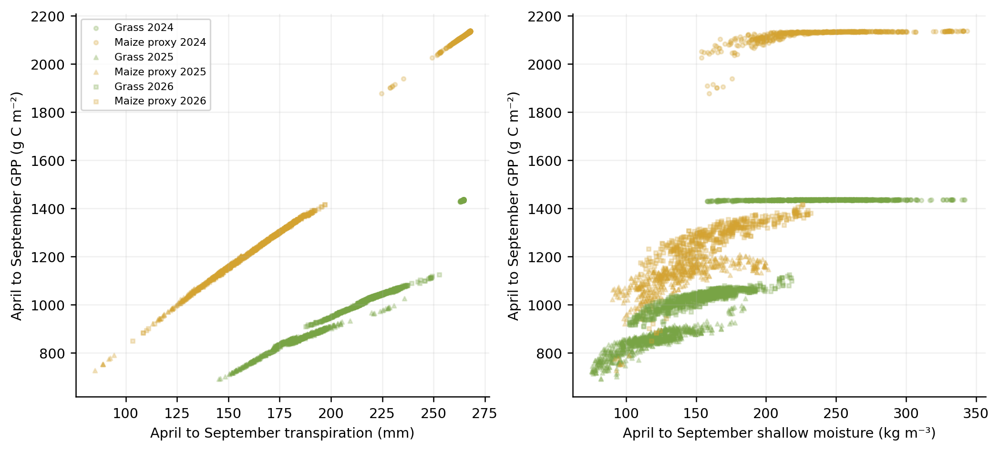

Figure 17. Cell-level matched-season gross carbon assimilation against transpiration and shallow soil water concentration. Marker shape distinguishes years and colour distinguishes crop. These associations arise from a model in which assimilation explicitly depends on water-stress reduction and crop development. They are not independent evidence that either modelled flux is correct.

The within-class correlation between seasonal GPP and transpiration exceeds 0.97 in every crop-year combination. In maize it is above 0.998. This should be expected in part from the source relationship GASS = PGASS × RELTR, where actual-to-potential transpiration contributes to the growth reduction. Reporting that correlation as validation would therefore be circular.

For a descriptive carbon-water diagnostic, divide seasonal gross carbon assimilation in g C m⁻² by seasonal transpiration in mm. One mm of water equals one kg m⁻², so the result has units g C per kg transpired water. The calculation concerns gross carbon and transpiration, not harvested dry matter and not total ET. Cells with less than 1 mm transpiration are excluded from this ratio to avoid unstable division.

| Year | Crop | Median g C per kg transpired water | Spatial P10 | Spatial P90 |
| --- | --- | --- | --- | --- |
| 2024 | Grass | 5.424 | 5.424 | 5.424 |
| 2024 | Maize proxy | 7.978 | 7.975 | 8.034 |
| 2025 | Grass | 4.678 | 4.577 | 4.761 |
| 2025 | Maize proxy | 7.797 | 7.688 | 7.977 |
| 2026 | Grass | 4.672 | 4.589 | 4.733 |
| 2026 | Maize proxy | 7.464 | 7.351 | 7.627 |

The maize diagnostic is around 8.0 g C kg⁻¹ in 2024 and 7.8 in 2025; grass is around 5.4 and 4.7. The very narrow 2024 within-class range largely reflects the common forcing, crop parameters and weak water limitation, rather than a quantified uncertainty bound. Crop-type differences include photosynthetic and management assumptions, so they are not a direct comparison of observed field water-use efficiencies.

The shallow-moisture relation is less direct. Different soils can have similar water concentration but different pressure heads or root-accessible stores. The near-horizontal 2024 clusters show that varying shallow concentration need not change assimilation when the configured crop is largely unstressed. A five-depth soil moisture series and a crop-response diagnostic provide complementary information; neither replaces the other.

## 12 Spatial spread and sensitivity to the analysis population

The model's spatial variation is conditional on the available inputs. Some differences reflect real source contrasts, while others reflect class assignments, donor profiles and explicit defaults. The spatial P10 and P90 below are percentiles of cell totals within a class in 2025. They are not confidence limits or an ensemble of alternative parameter sets.

| Class | 2025 cell ET minimum mm | Spatial P10 mm | Median mm | Spatial P90 mm | Maximum mm |
| --- | --- | --- | --- | --- | --- |
| Forest | 499.1 | 581.6 | 605.3 | 628.3 | 642.5 |
| Heath | 474.4 | 486.9 | 497.1 | 516.5 | 745.0 |
| Grass | 466.0 | 486.3 | 513.5 | 536.1 | 594.4 |
| Maize proxy | 408.6 | 470.0 | 499.4 | 531.4 | 570.0 |
| Urban surrogate | 457.1 | 478.2 | 504.5 | 523.0 | 570.6 |
| Wetland | 939.9 | 939.9 | 939.9 | 939.9 | 939.9 |

The heath class includes a few much higher ET columns than its median, consistent with the presence of different lower-boundary assignments among the broader heath group. The three wetland values are essentially identical at the precision shown. Repeated settings and shared forcing can produce repeated output; the number of mapped cells is not the number of independent measurements or independent parameter realisations.

A separate screening changes the population used for a mean without rerunning any physics. It first removes urban and wetland classes, then majority-water cells, then retains natural and crop columns with a dominant land fraction of at least 80% and zero mapped water fraction, and finally excludes soil-imputation flags. This tests the effect of reporting choices and class composition. It is not a correction of the full-domain result or a calibrated uncertainty analysis.

| Analysis population | Cells | 2025 season ET mm | Shallow moisture kg m⁻³ |
| --- | --- | --- | --- |
| All terrestrial columns | 4096 | 370.4 | 125.9 |
| Non urban natural or crop classes | 3697 | 372.8 | 123.4 |
| Natural or crop without water majority | 3680 | 372.8 | 123.4 |
| Natural or crop dominant fraction at least 80 percent | 1668 | 378.0 | 121.9 |
| Previous subset without imputed soil | 1585 | 377.5 | 121.6 |

The resulting ET means range from 370.4 to about 378.0 mm. The most restricted subset contains 1,585 cells and gives 377.5 mm, about 1.9% above the full-grid mean. That small shift does not bound the effect of better soil properties, groundwater coupling or different vegetation parameters, none of which were changed. It only shows that this particular selection rule modestly changes this particular reported mean.

## 13 Accounting flags and conversion verification

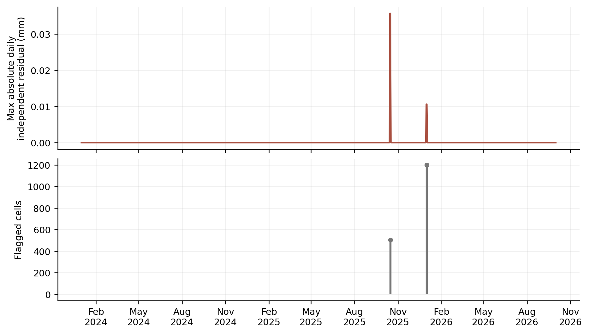

Figure 18. Largest absolute independent daily water residual over all cells, and the number of flagged cells. The two marked transitions are the 503 maize post-harvest events on 16 October 2025 and the 1,198 annual grass and urban events on 1 January 2026. Maximum residuals are small compared with seasonal evaporation, but they remain explicit daily physical-accounting limitations.

All original 4,096 columns completed their native runs. Of these, 2,395 have unflagged completion and 1,701 retain recognised canopy-calendar accounting flags. The original native fluxes, DSTOR and BALDEV are not modified by the conversion. The maximum recognised event is approximately 0.035682 mm, and the maximum annual-event residual is about 0.0106133 mm. Their small size does not justify calling those daily balances perfectly closed.

The candidate files have been checked over all cells, days and five depth levels. ET matches the requested sum exactly in float64. Temperature matches the source exactly. Converted moisture is stored as float32; the largest extra rounding difference from the exact 1,000 multiplication is about 0.0000153 kg m⁻³. Inverting every valid GPP value to daily carbon mass reproduces native GASST × CFRDM to the declared float64 tolerance. Cell identities, daily bounds, actual depths, assimilation availability and canopy flags are preserved.

These checks qualify the stated data conversion, not the original ecological or hydrological parameter choices. No comprehensive external CF conventions checker or agreement with an official SYMPHONICA schema is claimed. The source native NetCDF files remain immutable and are identified by their existing SHA-256 hashes.

## 14 Candidate products and practical use

| Candidate file | Daily intervals | Cells | Depths | Bytes |
| --- | --- | --- | --- | --- |
| SYMPHONICA_Kalmthout_V02_daily_2024.nc | 366 | 4096 | 5 | 67488217 |
| SYMPHONICA_Kalmthout_V02_daily_2025.nc | 365 | 4096 | 5 | 69959936 |
| SYMPHONICA_Kalmthout_V02_daily_2026.nc | 274 | 4096 | 5 | 52496496 |

The products retain the same annual partitioning as the native export. Each contains ET, soil_moisture, GPP and soil_temperature, plus ET_including_pond, pond_evaporation and the independent balance residual in mm. It retains the actual and requested depths, coordinates, vegetation and crop descriptions, spatial input flags and dynamic availability flags. crop_carbon_fraction records the active CFRDM used for the conversion.

ET and GPP use float64. Soil moisture and soil temperature use float32. Primary numeric arrays use zlib level 4 compression, shuffle and Fletcher32, with chunks of 32 days by 64 cells and all five depth values together where applicable. The converter writes a .partial file and renames it after completion. File-level metadata retains source file names and hashes, the baseline Git commit, water density, molar carbon mass, conversion definitions and the provisional mapping status.

For reproducibility, the accompanying package contains the three derived annual files, the conversion contract, reusable converter, analysis and plotting scripts, complete numeric tables, figure files and verification evidence. The original simulation files are already preserved in the V02 Git delivery. The analysis does not require a native rerun. Only completed .nc files are read; abandoned or in-progress .partial files are excluded.

The following example illustrates one annual conversion. The analysis and validation scripts use the same input directory and an explicit output directory.

```sh
python3 scripts/convert_symphonica.py \
  /path/to/Kalmthout_SW431_V02_daily_2025.nc \
  /path/to/SYMPHONICA_Kalmthout_V02_daily_2025.nc
python3 scripts/analyse_results.py /path/to/native/daily_netcdf /path/to/results
python3 scripts/validate_conversion.py /path/to/native/daily_netcdf /path/to/results
```

To aggregate ET over a period, integrate its daily mean rate over the corresponding interval durations. Here the intervals are all one day, so summing the daily numbers gives mm. To aggregate GPP to g C m⁻², multiply each mean flux by its duration in seconds, divide by one million and multiply by 12. To average moisture or temperature, average the requested day-end samples; do not sum them as fluxes. Retain actual depth and availability metadata with any extracted series.

A spatially complete map is not equivalent to a complete landscape process model. Do not treat the urban surrogate as a sewer model, a high-water-fraction soil column as a lake or net bottom outflow as a validated aquifer recharge product. For GPP, preserve missing values outside dynamic crops and state the represented area whenever aggregating available cells.

## 15 Priorities for a more informative next version

The current results point to a focused sequence of improvements. First, improve the hydrological relationship with the surroundings. Review groundwater observations, vertical reference levels, drainage and surface-water supply before changing lower boundaries. The contrast between freely draining classes and the three shallow-head wetland columns makes this a material uncertainty in seasonal transpiration and evaporation.

Second, establish a defensible hydrological and thermal spin-up. The first year loses 207.7 mm of native water storage, so initialisation is not a negligible bookkeeping issue. A controlled comparison should determine how much of the 2024-to-2025 contrast persists when the initial states and preceding climate history are treated consistently. Such a test would separate a weather contrast from an initial-state effect more clearly than the present chronological run can.

Third, align the pipeline with the standard datasets being collected and made accessible within SYMPHONICA. The agreement should cover source versions, identifiers, grid or feature support, CRS and vertical datum, temporal intervals, actual depth support, missing values and quality flags. It should also specify whether project evaporation includes ponded-water evaporation and whether GPP means a complete-day mean, daylight mean or a different temporal product. The units alone do not establish that semantic agreement.

For vegetation, use actual crop maps and management, distinguish managed grass from natural vegetation, and review prescribed forest and heath canopy demand. The large forest interception contribution and strong dry-season transpiration limitation deserve observational checks. Obtaining ecosystem GPP requires an appropriate assimilation model for forest and heath; filling their missing values by extrapolating crop means would add an unsupported assumption.

For soils, review donor-imputed cells, local restrictive horizons, organic layers and hydraulic parameter uncertainty. Compare moisture using pressure-head and retention information as well as kg m⁻³. For temperature, check the air-to-ground upper boundary, thermal properties and sensor depth matching before interpreting small biases. Numerical heat and frost hydrology should remain separate choices.

Finally, evaluate the four products against suitable independent observations with explicit temporal and spatial matching. A high correlation between two internally coupled model outputs is not such an evaluation. Field observations, source uncertainty and out-of-sample periods are needed to move from an executable technical exercise to a model with established predictive performance.

## Appendix A Monthly water accounting

Monthly values below are means across model columns followed by interval integration. All water quantities are in mm. The final October 2026 row covers one day only and must not be compared with complete months. Storage change is the native DSTOR accounting quantity. The CSV tables retain additional components and unrounded precision.

| Period | Days | P mm | ET mm | T mm | Bottom outflow mm | Storage change mm |
| --- | --- | --- | --- | --- | --- | --- |
| 2024-01 | 31 | 65.3 | 19.2 | 4.2 | 179.4 | -133.3 |
| 2024-02 | 29 | 129.0 | 26.9 | 3.8 | 57.6 | 44.4 |
| 2024-03 | 31 | 79.3 | 47.4 | 10.0 | 71.9 | -39.9 |
| 2024-04 | 30 | 102.9 | 81.1 | 18.5 | 44.1 | -22.3 |
| 2024-05 | 31 | 162.7 | 122.8 | 41.9 | 33.0 | 6.9 |
| 2024-06 | 30 | 74.5 | 138.9 | 79.4 | 29.6 | -94.1 |
| 2024-07 | 31 | 95.2 | 123.8 | 59.8 | 13.0 | -41.6 |
| 2024-08 | 31 | 78.2 | 99.3 | 47.1 | 7.0 | -28.1 |
| 2024-09 | 30 | 92.2 | 79.0 | 24.5 | 4.1 | 9.1 |
| 2024-10 | 31 | 66.8 | 42.7 | 14.3 | 2.9 | 21.2 |
| 2024-11 | 30 | 67.0 | 22.0 | 5.3 | 3.1 | 41.8 |
| 2024-12 | 31 | 57.8 | 19.9 | 3.5 | 9.7 | 28.2 |
| 2025-01 | 31 | 119.7 | 16.3 | 2.2 | 25.3 | 78.1 |
| 2025-02 | 28 | 43.2 | 23.4 | 4.5 | 34.8 | -15.0 |
| 2025-03 | 31 | 10.3 | 57.3 | 15.0 | 27.3 | -74.3 |
| 2025-04 | 30 | 25.9 | 67.6 | 27.5 | 12.1 | -53.7 |
| 2025-05 | 31 | 37.6 | 64.3 | 32.7 | 6.1 | -32.8 |
| 2025-06 | 30 | 46.7 | 70.8 | 28.0 | 3.4 | -27.4 |
| 2025-07 | 31 | 76.3 | 83.4 | 28.9 | 2.3 | -9.3 |
| 2025-08 | 31 | 24.2 | 32.1 | 10.0 | 1.5 | -9.4 |
| 2025-09 | 30 | 45.8 | 52.2 | 11.1 | 1.1 | -7.6 |
| 2025-10 | 31 | 83.1 | 42.8 | 6.9 | 1.0 | 39.3 |
| 2025-11 | 30 | 59.9 | 23.8 | 5.9 | 0.8 | 35.3 |
| 2025-12 | 31 | 28.0 | 24.5 | 5.8 | 0.8 | 2.7 |
| 2026-01 | 31 | 69.1 | 16.2 | 2.7 | 2.2 | 50.7 |
| 2026-02 | 28 | 90.4 | 25.2 | 3.5 | 6.7 | 58.5 |
| 2026-03 | 31 | 57.3 | 58.3 | 13.7 | 19.4 | -20.4 |
| 2026-04 | 30 | 18.3 | 75.6 | 29.8 | 13.2 | -70.5 |
| 2026-05 | 31 | 92.3 | 114.4 | 52.3 | 7.4 | -29.5 |
| 2026-06 | 30 | 73.8 | 100.8 | 38.0 | 4.2 | -31.2 |
| 2026-07 | 31 | 14.3 | 29.2 | 14.7 | 2.8 | -17.7 |
| 2026-08 | 31 | 68.6 | 60.4 | 16.1 | 1.9 | 6.3 |
| 2026-09 | 30 | 57.2 | 62.9 | 19.2 | 1.4 | -7.1 |
| 2026-10 | 1 | 3.7 | 2.7 | 0.4 | 0.0 | 0.9 |

## Appendix B Evidence and source interpretation

The source simulation is pinned to Git commit 48c7897c6500309e5e83377986ca2ff3e20917e3. It is the complete locally refined V02 grid with native numerical heat and WOFOST grass and maize. The construction note describes original source datasets, parameter transfer, model execution and known limitations. This note analyses those outputs without changing the native simulations.

The machine-readable conversion_contract.json is the explicit mapping definition. GPP_source_derivation.json retains source excerpts and source hashes for the carbon-fraction conversion, gross assimilation, output accumulation and interval reset. conversion_validation.json records complete-array checks. analysis_summary.json identifies the source and derived files, represented populations and annual and matched-season summaries. Every figure is generated from retained aggregate arrays and tables by the included plotting script.

The exact SWAP 4.3.1 source is the primary authority for the CFRDM correction. General WOFOST documentation explains the relationship between daily gross CO2 assimilation and carbohydrate equivalents, but a generic 30/44 equation without this source-version detail is insufficient for the current grass file. External context is available from the SWAP theory and user guide at https://swap.wur.nl/manual/ and the WOFOST assimilation documentation and source at https://github.com/ajwdewit/pcse/blob/master/pcse/crop/assimilation.py . Those references do not independently validate the Kalmthout application.

Spatial percentile bands and class differences in this note describe one deterministic simulation under shared meteorology. They are not uncertainty ensembles. The three available periods are not a climatic reference distribution. Those distinctions should remain visible when the products enter the broader SYMPHONICA comparison and data-delivery workflow.
